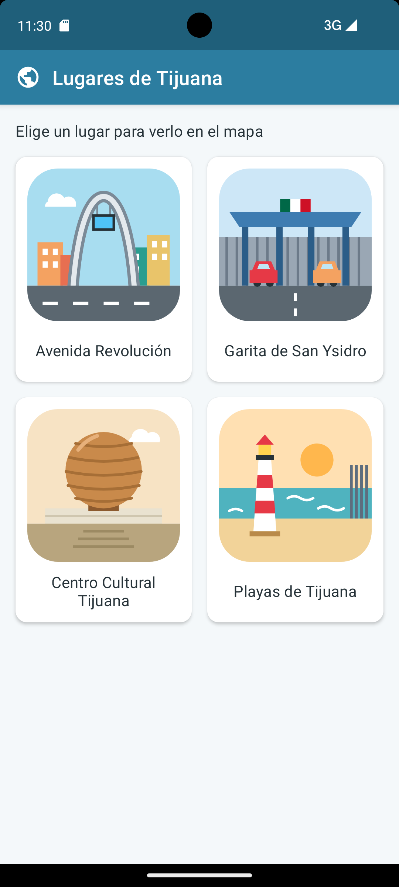
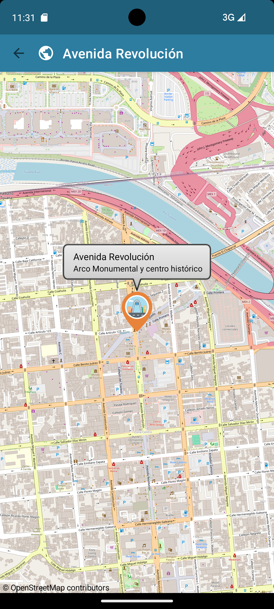
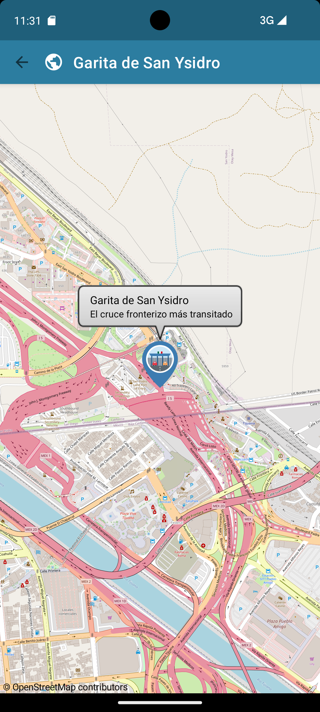
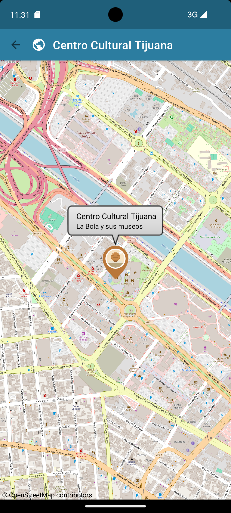
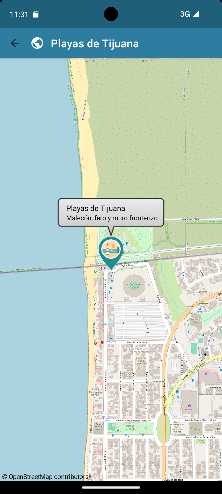

# Lugares de Tijuana

Menú con los 4 lugares más concurridos de Tijuana. Cada uno abre un mapa con un puntero personalizado en su ubicación. Hecho en Java y XML.

| Lugar | Latitud | Longitud |
|---|---|---|
| Avenida Revolución | 32.53635 | -117.03701 |
| Garita de San Ysidro | 32.54333 | -117.02972 |
| Centro Cultural Tijuana | 32.53000 | -117.02389 |
| Playas de Tijuana | 32.53423 | -117.12278 |

El mapa es de OpenStreetMap con la librería osmdroid, así que el proyecto corre sin API key ni cuenta de facturación.

## Capturas

| Menú | Avenida Revolución | Garita de San Ysidro | CECUT | Playas de Tijuana |
|---|---|---|---|---|
|  |  |  |  |  |
