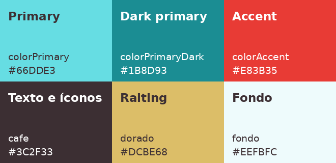
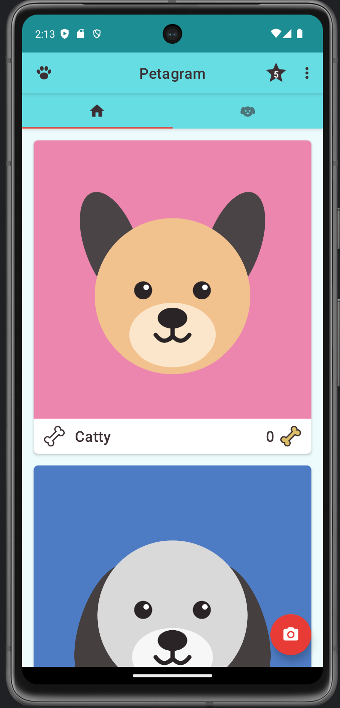
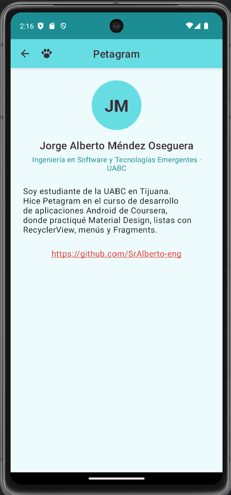
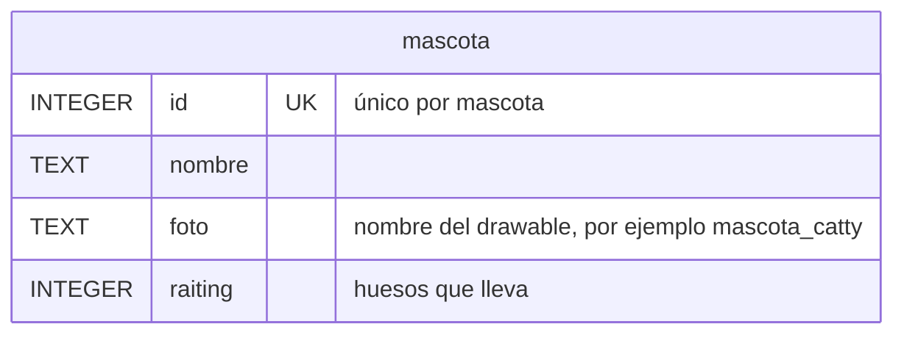
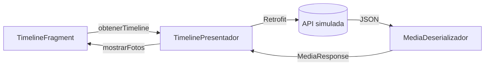
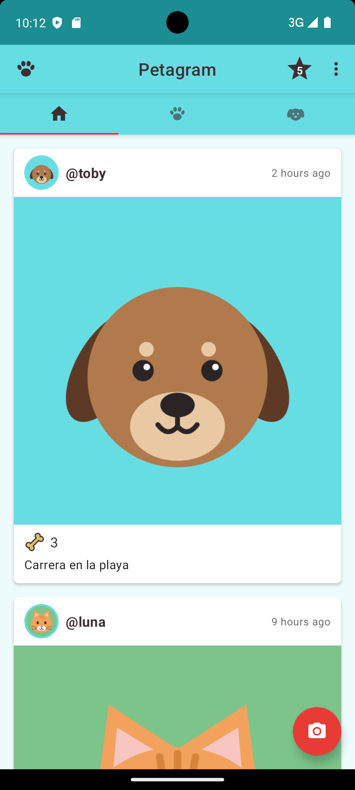
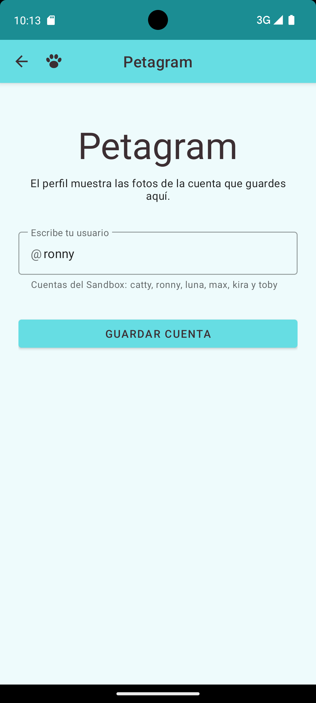
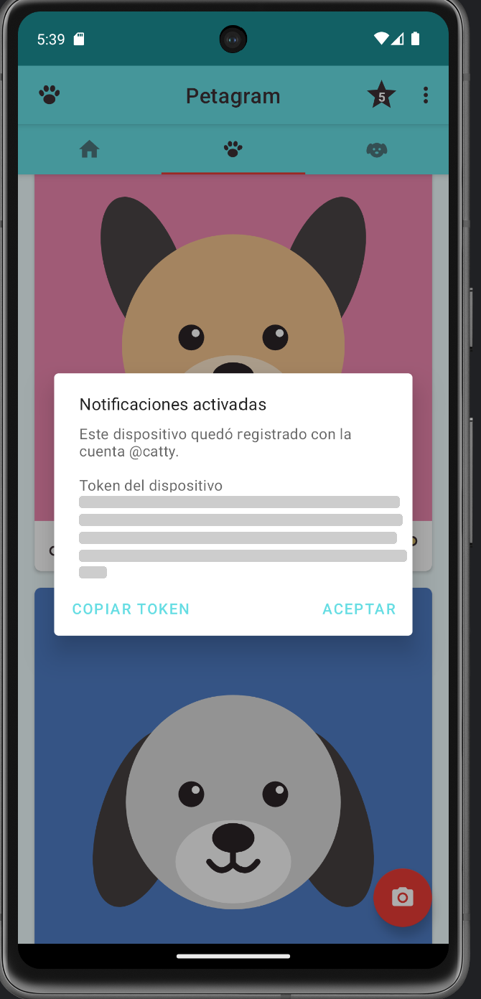
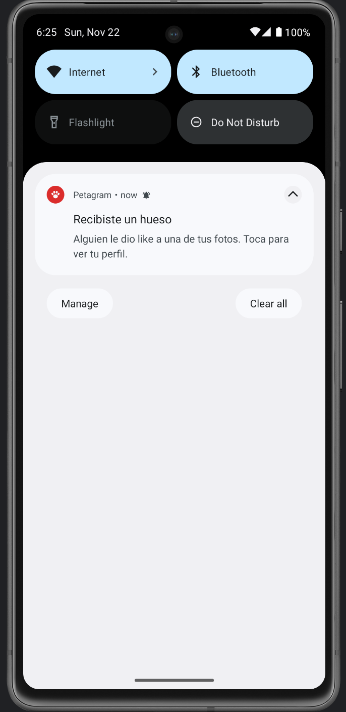
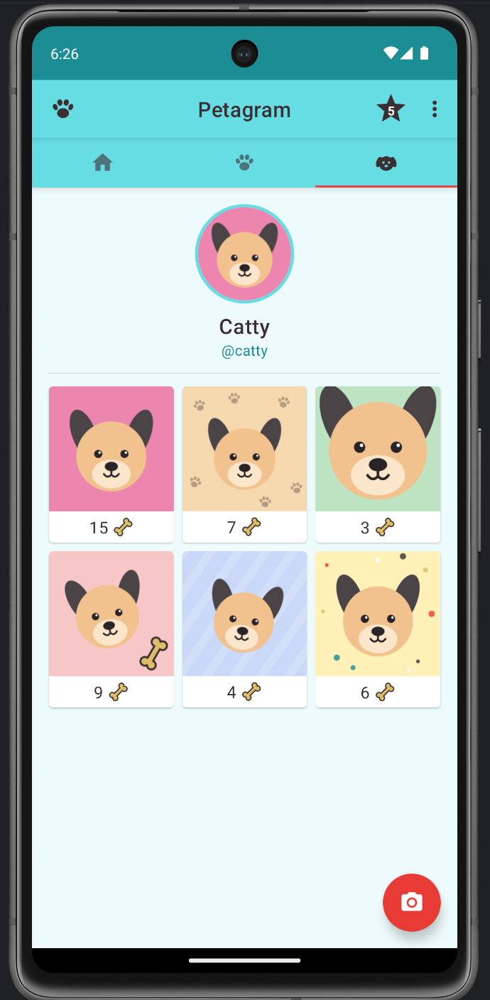

# Petagram

Proyecto del curso de desarrollo de aplicaciones móviles con Android. Hecho en Java y layouts XML.

Módulos elaborados del curso

1. **Módulo 1.** Identidad con Material Design a partir del logotipo de Puppy.
2. **Módulo 2.** Petagram, una lista de mascotas a las que les puedes dar huesos, más una pantalla con las 5 favoritas.
3. **Módulo 6.** Menús y Fragments. Pestañas con ViewPager, perfil de la mascota, formulario de Contacto que manda correo con JavaMail y pantalla de Acerca de.
4. **Módulo 8.** Base de datos. Las 5 favoritas se guardan en SQLite y cambian cada vez que le das un hueso a una mascota.
5. **Retrofit y API de Instagram.** Timeline con las fotos recientes de las cuentas del Sandbox, perfil del usuario principal y pantalla para elegirlo. Usa Retrofit, deserializadores de Gson y el patrón Modelo Vista Presentador.
6. **Notificaciones con Firebase.** Opción Recibir notificaciones que registra el token de FCM del dispositivo en un web service propio.
7. **Likes con notificación.** Hueso blanco en el timeline para dar like a una foto. El web service registra el like y le avisa al dueño de la foto con una notificación que abre su perfil.
8. **Android Wear.** La notificación del like tiene las acciones Ver mi perfil, Dar follow o unfollow y Ver usuario. También se ven y funcionan en un reloj con Wear OS.
9. **Transiciones.** Cada cambio de pantalla tiene una transición distinta. Unas están hechas en XML y otras en Java.

## Módulo 2 - Capturas

| Lista de mascotas | 5 mascotas favoritas |
|---|---|
|  |  |

## Identidad



| Rol | Color | Del logo | Dónde se usa |
|---|---|---|---|
| Primary | `#66DDE3` | Fondo cian | Toolbar y fondo del ícono de la app |
| Dark primary | `#1B8D93` | El mismo cian, más oscuro | Barra de estado |
| Accent | `#E83B35` | Collar y techo de la casita | Botón flotante de la cámara |
| Texto e íconos | `#3C2F33` | Letras "Puppy" y piso | Título, huella, estrella, nombres |
| Raiting | `#DCBE68` | Placa del collar | Hueso dorado |
| Fondo | `#EEFBFC` | Cian muy claro | Fondo de las pantallas |


## Módulo 6 - Capturas

| Inicio | Perfil de la mascota | Menú |
|---|---|---|
|  |  |  |

| Contacto | Acerca de |
|---|---|
|  |  |

## Módulo 8 - Capturas

| Lista con huesos | Últimas 5 favoritas |
|---|---|
|  |  |

## Módulo 8 - Modelo de base de datos



Es una sola tabla con los mismos campos que la clase `Mascota`. La foto se guarda por nombre porque el número de `R.drawable` puede cambiar cada vez que compilas.

Para saber cuáles son las más recientes se usa el `rowid`, un número que SQLite le da a cada fila y que crece con cada inserción. Al darle un hueso a una mascota, su fila se borra y se vuelve a insertar, así queda como la más reciente. Después se borran las filas que no estén entre las 5 más nuevas.

## Retrofit y API de Instagram

El curso pide consumir el API v1 de Instagram en modo Sandbox. Ese API ya no existe. Meta lo cerró en 2020 y su reemplazo para cuentas personales, el Basic Display API, dejó de funcionar el 4 de diciembre de 2024. El API que queda solo da acceso a cuentas profesionales, pide un token que caduca y no deja leer las fotos de otras cuentas.

Por eso Petagram consume una copia simulada del API que vive en la carpeta [`api/`](api/) de este repo. La copia respeta las rutas y el formato JSON del API v1. Retrofit la pide al web service de Petagram en la ruta `/v1`, que lee esos JSON y les suma los likes que se dan desde la app. Esto significa que el proyecto corre sin tokens ni cuentas de desarrollador. Las cuentas del Sandbox son las seis mascotas de la app: catty, ronny, luna, max, kira y toby.

### Endpoints

La URL base es `https://petagram-ws.sralberto.workers.dev/v1/`. En el API real era `https://api.instagram.com/v1/`. Todas las peticiones mandan el parámetro `access_token`, como lo pedía Instagram.

| Endpoint | Qué regresa | Dónde se usa | Deserializador |
|---|---|---|---|
| `GET users/self/follows` | Las cuentas que aceptaron la invitación al Sandbox | Timeline | `UsuariosDeserializador` |
| `GET users/{user-id}/media/recent` | Las fotos recientes de una cuenta con sus likes | Timeline y perfil | `MediaDeserializador` |
| `GET users/search?q={usuario}` | Las cuentas que coinciden con el usuario buscado | Perfil y Configurar cuenta | `UsuariosDeserializador` |
| `POST media/{media-id}/likes` | `meta.code` en 200 si el like quedó guardado | Timeline | Ninguno, Gson llena `LikeResponse` |
| `GET` y `POST users/{user-id}/relationship` | Si la cuenta del token sigue a la otra | Notificación del like | Ninguno, Gson llena `RelacionResponse` |

El timeline pide primero la lista de cuentas y después las fotos de cada una. Cuando llegan todas, las ordena de la más nueva a la más vieja. El perfil busca al usuario principal para conocer su id y luego pide sus fotos. Configurar cuenta usa la misma búsqueda para revisar que la cuenta exista antes de guardarla en SharedPreferences.

Como los archivos son estáticos, el servidor simulado ignora el parámetro `q` y siempre regresa todas las cuentas. La app se queda con la que tiene exactamente ese username. Con el API real haría falta lo mismo, porque la búsqueda de Instagram también regresa cuentas con nombres parecidos.

### Modelos, respuestas y deserializadores

Gson no convierte el JSON campo por campo. Cada respuesta tiene un deserializador que lee solo lo que usa la app y arma los objetos del modelo. `RestApiAdaptador` registra los deserializadores en Gson y le pasa ese Gson a Retrofit.

Los modelos son `Foto` y `UsuarioInstagram`, y las respuestas son `MediaResponse` y `UsuariosResponse`. De cada foto se leen el id, la cuenta que la subió, la imagen `standard_resolution` para el timeline, la `low_resolution` para el perfil, el texto, los likes y la fecha. Los likes se muestran como huesos, igual que el raiting de las mascotas.

### Modelo Vista Presentador

Las tres pantallas de este módulo siguen MVP. La vista es un Fragment o una Activity que implementa una interfaz como `ITimelineVista`. El presentador recibe esa interfaz, hace las peticiones con Retrofit y le dice a la vista qué mostrar. La vista no sabe nada de Retrofit y el presentador no toca ningún View.



Cuando la vista se destruye, el presentador cancela las peticiones pendientes para no tocar pantallas que ya no existen. Las pantallas de los módulos anteriores se quedaron como estaban.

### Capturas

| Timeline | Perfil | Menú | Configurar cuenta |
|---|---|---|---|
|  |  |  |  |

## Notificaciones con Firebase

La opción **Recibir notificaciones** del menú pide el token del dispositivo a Firebase Cloud Messaging y lo manda, junto con el id de Instagram del usuario principal, al web service.

El web service está en [`servidor/`](servidor/). Corre en Cloudflare Workers y guarda los datos en una base D1, porque Heroku ya no tiene plan gratis.

`google-services.json` no está en el repositorio para no publicar las credenciales de Firebase. Para recibir notificaciones, registra el paquete `com.sralberto.petagram` en un proyecto de Firebase y copia su `google-services.json` en `app/`. Sin ese archivo la app compila y la opción avisa que falta configurar Firebase.

```
POST https://petagram-ws.sralberto.workers.dev/registrar-usuario
id_dispositivo=<token de FCM>&id_usuario_instagram=1002

200 {"id":1,"id_dispositivo":"<token de FCM>","id_usuario_instagram":"1002"}
400 {"error":"Faltan id_dispositivo o id_usuario_instagram"}
```

Tabla `usuario_instagram`: `id`, `id_dispositivo` único, `id_usuario_instagram`, `creado` y `actualizado`. Si un dispositivo se registra otra vez, se actualiza su usuario.

Para publicarlo:

```
cd servidor
npx wrangler login
npx wrangler d1 create petagram
npx wrangler d1 execute petagram --remote --file schema.sql
npx wrangler deploy
```

Explicación del endpoint en [Petagram_Notificaciones_Endpoint.pdf](docs/Petagram_Notificaciones_Endpoint.pdf).



## Likes con notificación

Cada foto del timeline tiene un hueso blanco. Al tocarlo, la app hace tres pasos.

1. Da el like en Instagram con `POST media/{media-id}/likes`.
2. Pide el token de FCM del celular.
3. Manda el like a `POST /registrar-like`. El web service lo guarda y le manda una notificación a cada celular registrado con la cuenta dueña de la foto.

Al tocar la notificación, la app abre la pestaña del perfil y lo recarga para mostrar el hueso nuevo.

```
POST https://petagram-ws.sralberto.workers.dev/registrar-like
id_foto_instagram=1795277700000_1002&id_usuario_instagram=1002&id_dispositivo=<token de FCM>

200 {"id":1,"id_foto_instagram":"1795277700000_1002","id_usuario_instagram":"1002","id_dispositivo":"<token de FCM>","dispositivos":1,"notificaciones_enviadas":1}
400 {"error":"Faltan id_foto_instagram, id_usuario_instagram o id_dispositivo"}
400 {"error":"La foto no pertenece a id_usuario_instagram"}
```

`id_usuario_instagram` es el dueño de la foto e `id_dispositivo` es el celular que dio el like. El like queda en la tabla `like_foto`. Para mandar la notificación, el web service usa el API HTTP v1 de FCM con una cuenta de servicio de Firebase. Esa llave es un secreto de Cloudflare y no está en el repositorio. Se sube una sola vez antes de publicar. Firebase solo entrega la notificación si la app del celular se compiló con el `google-services.json` del mismo proyecto que la cuenta de servicio.

```
Get-Content <llave de la cuenta de servicio>.json -Raw | npx wrangler secret put FCM_CUENTA_SERVICIO
```

Explicación del endpoint en [Petagram_Likes_Endpoint.pdf](docs/Petagram_Likes_Endpoint.pdf).

 

## Notificación con acciones para Android Wear

La notificación de un like tiene tres acciones. En un reloj con Wear OS aparecen como botones debajo de la notificación gracias a `NotificationCompat.WearableExtender`. Las acciones son estas:

1. Ver mi perfil abre la app en la pestaña del perfil de la cuenta del celular.
2. Dar follow o Dar unfollow sigue o deja de seguir a la cuenta que dio el like sin abrir la app. Lo hace `SeguirReceiver`, y al terminar la notificación cambia a la acción contraria.
3. Ver usuario abre `UsuarioActivity` con las fotos recientes de la cuenta que dio el like.

Para que las acciones salgan aunque la app esté cerrada, `/registrar-like` manda un mensaje de FCM solo de datos y `PetagramMessagingService` arma la notificación. El servidor sabe qué cuenta dio el like por el celular que lo mandó. Por eso los dos celulares deben haber tocado Recibir notificaciones.

Follow y unfollow usan el endpoint de relaciones de Instagram:

```
POST https://petagram-ws.sralberto.workers.dev/v1/users/1005/relationship
access_token=petagram.sandbox.1001&action=follow

200 {"meta":{"code":200},"data":{"outgoing_status":"follows","target_user_is_private":false}}
400 {"meta":{"error_type":"APIInvalidParametersError","code":400,"error_message":"you cannot follow yourself"}}
```

En el API real cada cuenta tenía su propio `access_token`. En la copia simulada, el token de este endpoint termina con el id de la cuenta que sigue. Con `GET` en la misma ruta se consulta si ya la sigue, y así la notificación muestra Dar follow o Dar unfollow desde el inicio.

## Transiciones

Cada pantalla que se abre desde MainActivity define su transición de entrada. Al regresar, Android la reproduce al revés. MainActivity abre las pantallas con `ActivityOptionsCompat.makeSceneTransitionAnimation`, porque sin esas opciones Android usa su animación normal.

| Cambio de pantalla | Transición | Hecha en |
|---|---|---|
| Estrella a Favoritas | `Explode`. Las tarjetas salen desde el centro | Java, `Transiciones.explotar()` |
| Menú a Contacto | `Slide` desde la orilla derecha | XML, `res/transition/deslizar_derecha.xml` cargado con `TransitionInflater` |
| Menú a Acerca de | `Slide` desde abajo junto con `Fade` | XML, `res/transition/aparecer_desde_abajo.xml` puesto en el tema `Theme.Petagram.AcercaDe` |
| Menú a Configurar cuenta | `TransitionSet` con `Slide` desde arriba y `Fade` | Java, `Transiciones.bajarDesdeArriba()` |
| Entre pestañas | La pestaña que sale se encoge y se vuelve transparente | Java, `TransformadorZoom` en el `ViewPager2` |

La flecha de regresar llama a `supportFinishAfterTransition()` para que también se vea la transición de salida.

## Estructura

```
Petagram/
├── api/                             API simulada con el formato de Instagram v1
│   ├── v1/users/...                 respuestas JSON de cada endpoint
│   ├── media/                       fotos y fotos de perfil
│   └── generar_api.py               script que genera los JSON y las fotos
├── servidor/                        web service en Cloudflare Workers con D1
└── app/src/main/
    ├── AndroidManifest.xml
    ├── java/com/sralberto/petagram/
    │   ├── MainActivity.java            barra, pestañas, menú y botón flotante
    │   ├── PaginasAdaptador.java        qué Fragment va en cada pestaña
    │   ├── ListaMascotasFragment.java   lista de mascotas
    │   ├── FavoritasActivity.java       5 favoritas
    │   ├── ContactoActivity.java        formulario de contacto
    │   ├── CorreoContacto.java          envío con JavaMail
    │   ├── AcercaDeActivity.java        bio del desarrollador
    │   ├── BaseDatosMascotas.java       tabla mascota en SQLite
    │   ├── Mascota.java / MascotaAdaptador.java
    │   ├── modelo/                      Foto, UsuarioInstagram y CuentaPrincipal
    │   ├── vista/                       interfaces de las vistas, ConfigurarCuentaActivity y UsuarioActivity
    │   │   └── fragment/                TimelineFragment y PerfilMascotaFragment
    │   ├── presentador/                 un presentador y su interfaz por pantalla
    │   ├── adaptador/                   TimelineAdaptador y FotoAdaptador
    │   ├── notificaciones/              servicio de FCM, notificación con acciones y SeguirReceiver
    │   ├── transiciones/                transiciones hechas en Java y TransformadorZoom
    │   └── restapi/                     EndpointsApi, ConstantesRestApi y JsonKeys
    │       ├── adaptador/               RestApiAdaptador
    │       ├── modelo/                  respuestas de Instagram y del web service
    │       └── deserializador/          MediaDeserializador y UsuariosDeserializador
    └── res/
        ├── drawable/            mascotas, huesos, huella, estrella, cámara, íconos de pestañas
        ├── layout/              activities, fragments, items, toolbar, estado de carga
        ├── menu/                menu_principal.xml
        ├── transition/          transiciones hechas en XML
        ├── mipmap-anydpi-v26/   ic_launcher.xml
        └── values/              colors, themes, strings, dimens
```
