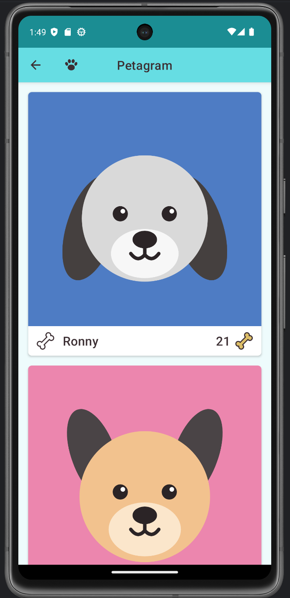

# Petagram

Proyecto del curso de desarrollo de aplicaciones móviles con Android. Hecho en Java y layouts XML.

Módulos elaborados del curso

1. **Módulo 1.** Identidad con Material Design a partir del logotipo de Puppy.
2. **Módulo 2.** Petagram, una lista de mascotas a las que les puedes dar huesos, más una pantalla con las 5 favoritas.

## Capturas

| Lista de mascotas | 5 mascotas favoritas |
|---|---|
|  |  |

## Módulo 1. Identidad

Todos los colores salen del logo de Puppy.


| Rol | Color | Del logo | Dónde se usa |
|---|---|---|---|
| Primary | `#66DDE3` | Fondo cian | Toolbar y fondo del ícono de la app |
| Dark primary | `#1B8D93` | El mismo cian, más oscuro | Barra de estado |
| Accent | `#E83B35` | Collar y techo de la casita | Botón flotante de la cámara |
| Texto e íconos | `#3C2F33` | Letras "Puppy" y piso | Título, huella, estrella, nombres |
| Raiting | `#DCBE68` | Placa del collar | Hueso dorado |
| Fondo | `#EEFBFC` | Cian muy claro | Fondo de las pantallas |

## Módulo 2. Petagram

## Notas

- Las ilustraciones de las mascotas y los íconos son vectores hechos para este proyecto. La estrella es el ícono "star" de Material Icons, en lugar del de icons8 que sugiere la actividad.
- Los huesos se guardan solo en memoria. Si giras el teléfono o cierras la app, regresan a 0.

## Estructura

```
app/src/main/
├── AndroidManifest.xml
├── java/com/sralberto/petagram/
│   ├── MainActivity.java          lista de mascotas
│   ├── FavoritasActivity.java     5 favoritas
│   ├── Mascota.java               entidad
│   └── MascotaAdaptador.java      adapter y ViewHolder
└── res/
    ├── drawable/            mascotas, huesos, huella, estrella, cámara
    ├── layout/              activity_main, activity_favoritas, item_mascota,
    │                        toolbar, action_view_favoritas
    ├── menu/                menu_principal.xml
    ├── mipmap-anydpi-v26/   ic_launcher.xml
    └── values/              colors, themes, strings, dimens
```