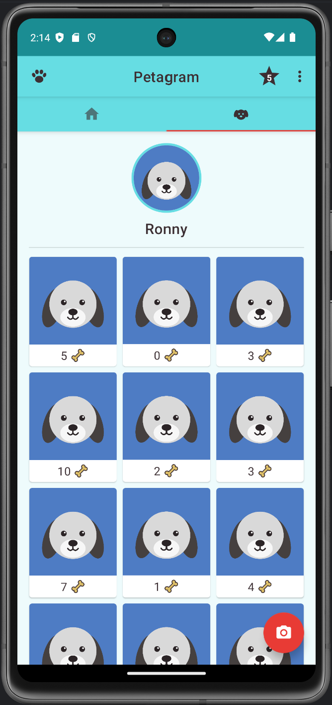

# Petagram

Proyecto del curso de desarrollo de aplicaciones móviles con Android. Hecho en Java y layouts XML.

Módulos elaborados del curso

1. **Módulo 1.** Identidad con Material Design a partir del logotipo de Puppy.
2. **Módulo 2.** Petagram, una lista de mascotas a las que les puedes dar huesos, más una pantalla con las 5 favoritas.
3. **Módulo 6.** Menús y Fragments. Pestañas con ViewPager, perfil de la mascota, formulario de Contacto que manda correo con JavaMail y pantalla de Acerca de.

## Módulo 2 - Capturas

| Lista de mascotas | 5 mascotas favoritas |
|---|---|
|  |  |

## Identidad


| Rol | Color | Del logo | Dónde se usa |
|---|---|---|---|
| Primary | `#66DDE3` | Fondo cian | Toolbar y fondo del ícono de la app |
| Dark primary | `#1B8D93` | El mismo cian, más oscuro | Barra de estado |
| Accent | `#E83B35` | Collar y techo de la casita | Botón flotante de la cámara |
| Texto e íconos | `#3C2F33` | Letras "Puppy" y piso | Título, huella, estrella, nombres |
| Raiting | `#DCBE68` | Placa del collar | Hueso dorado |
| Fondo | `#EEFBFC` | Cian muy claro | Fondo de las pantallas |


## Módulo 6 - Capturas

| Inicio | Perfil de la mascota | Menú |
|---|---|---|
|  |  |  |

| Contacto | Acerca de |
|---|---|
|  |  |

## Estructura

```
app/src/main/
├── AndroidManifest.xml
├── java/com/sralberto/petagram/
│   ├── MainActivity.java            barra, pestañas, menú y botón flotante
│   ├── PaginasAdaptador.java        qué Fragment va en cada pestaña
│   ├── ListaMascotasFragment.java   lista de mascotas
│   ├── PerfilMascotaFragment.java   perfil de Ronny
│   ├── FavoritasActivity.java       5 favoritas
│   ├── ContactoActivity.java        formulario de contacto
│   ├── CorreoContacto.java          envío con JavaMail
│   ├── AcercaDeActivity.java        bio del desarrollador
│   ├── Mascota.java / Foto.java     entidades
│   └── MascotaAdaptador.java / FotoAdaptador.java
└── res/
    ├── drawable/            mascotas, huesos, huella, estrella, cámara, íconos de pestañas
    ├── layout/              activities, fragments, items, toolbar, action_view_favoritas
    ├── menu/                menu_principal.xml
    ├── mipmap-anydpi-v26/   ic_launcher.xml
    └── values/              colors, themes, strings, dimens
```
