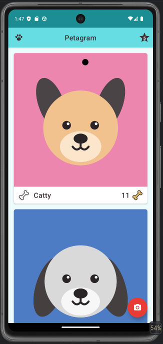
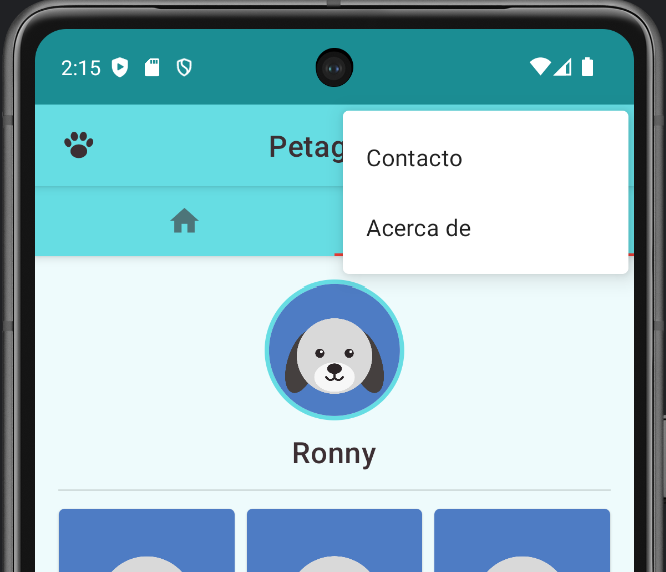
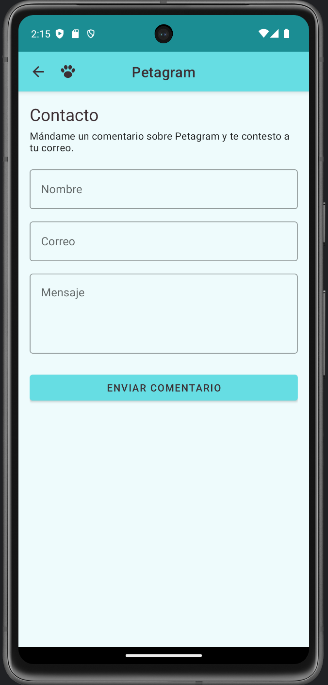
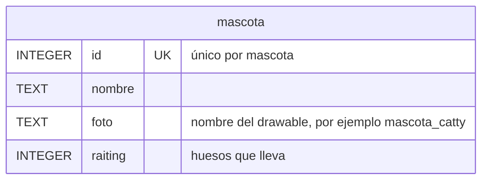
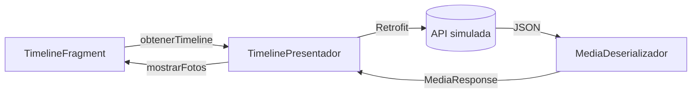
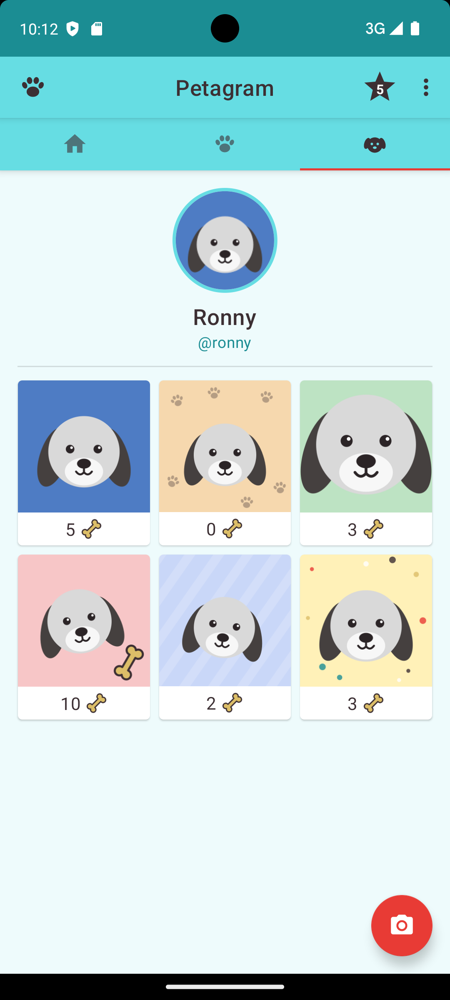
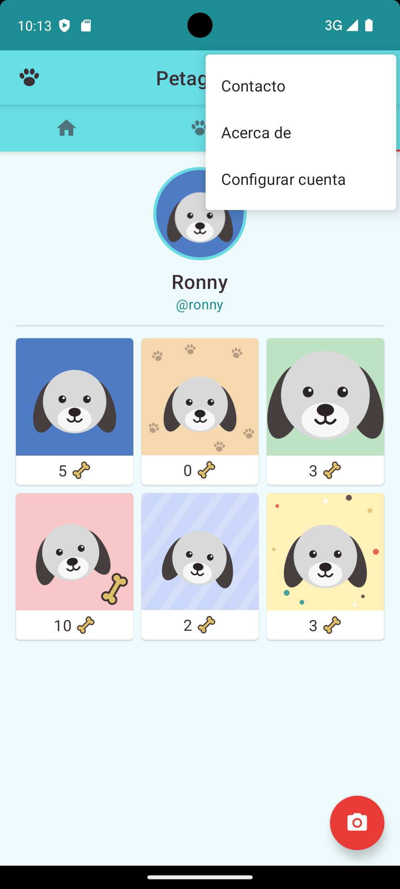

# Petagram

Proyecto del curso de desarrollo de aplicaciones móviles con Android. Hecho en Java y layouts XML.

Módulos elaborados del curso

1. **Módulo 1.** Identidad con Material Design a partir del logotipo de Puppy.
2. **Módulo 2.** Petagram, una lista de mascotas a las que les puedes dar huesos, más una pantalla con las 5 favoritas.
3. **Módulo 6.** Menús y Fragments. Pestañas con ViewPager, perfil de la mascota, formulario de Contacto que manda correo con JavaMail y pantalla de Acerca de.
4. **Módulo 8.** Base de datos. Las 5 favoritas se guardan en SQLite y cambian cada vez que le das un hueso a una mascota.
5. **Retrofit y API de Instagram.** Timeline con las fotos recientes de las cuentas del Sandbox, perfil del usuario principal y pantalla para elegirlo. Usa Retrofit, deserializadores de Gson y el patrón Modelo Vista Presentador.

## Módulo 2 - Capturas

| Lista de mascotas | 5 mascotas favoritas |
|---|---|
|  |  |

## Identidad


| Rol | Color | Del logo | Dónde se usa |
|---|---|---|---|
| Primary | `#66DDE3` | Fondo cian | Toolbar y fondo del ícono de la app |
| Dark primary | `#1B8D93` | El mismo cian, más oscuro | Barra de estado |
| Accent | `#E83B35` | Collar y techo de la casita | Botón flotante de la cámara |
| Texto e íconos | `#3C2F33` | Letras "Puppy" y piso | Título, huella, estrella, nombres |
| Raiting | `#DCBE68` | Placa del collar | Hueso dorado |
| Fondo | `#EEFBFC` | Cian muy claro | Fondo de las pantallas |


## Módulo 6 - Capturas

| Inicio | Perfil de la mascota | Menú |
|---|---|---|
|  |  |  |

| Contacto | Acerca de |
|---|---|
|  |  |

## Módulo 8 - Capturas

| Lista con huesos | Últimas 5 favoritas |
|---|---|
|  |  |

## Módulo 8 - Modelo de base de datos



Es una sola tabla con los mismos campos que la clase `Mascota`. La foto se guarda por nombre porque el número de `R.drawable` puede cambiar cada vez que compilas.

Para saber cuáles son las más recientes se usa el `rowid`, un número que SQLite le da a cada fila y que crece con cada inserción. Al darle un hueso a una mascota, su fila se borra y se vuelve a insertar, así queda como la más reciente. Después se borran las filas que no estén entre las 5 más nuevas.

## Retrofit y API de Instagram

El curso pide consumir el API v1 de Instagram en modo Sandbox. Ese API ya no existe. Meta lo cerró en 2020 y su reemplazo para cuentas personales, el Basic Display API, dejó de funcionar el 4 de diciembre de 2024. El API que queda solo da acceso a cuentas profesionales, pide un token que caduca y no deja leer las fotos de otras cuentas.

Por eso Petagram consume una copia simulada del API que vive en la carpeta [`api/`](api/) de este repo. La copia respeta las rutas y el formato JSON del API v1, y Retrofit la pide por internet desde `raw.githubusercontent.com`. Esto significa que el proyecto corre sin tokens ni cuentas de desarrollador. Las cuentas del Sandbox son las seis mascotas de la app: catty, ronny, luna, max, kira y toby.

### Endpoints

La URL base es `https://raw.githubusercontent.com/SrAlberto-eng/coursera-android/main/Petagram/api/v1/`. En el API real era `https://api.instagram.com/v1/`. Todas las peticiones mandan el parámetro `access_token`, como lo pedía Instagram.

| Endpoint | Qué regresa | Dónde se usa | Deserializador |
|---|---|---|---|
| `GET users/self/follows` | Las cuentas que aceptaron la invitación al Sandbox | Timeline | `UsuariosDeserializador` |
| `GET users/{user-id}/media/recent` | Las fotos recientes de una cuenta con sus likes | Timeline y perfil | `MediaDeserializador` |
| `GET users/search?q={usuario}` | Las cuentas que coinciden con el usuario buscado | Perfil y Configurar cuenta | `UsuariosDeserializador` |

El timeline pide primero la lista de cuentas y después las fotos de cada una. Cuando llegan todas, las ordena de la más nueva a la más vieja. El perfil busca al usuario principal para conocer su id y luego pide sus fotos. Configurar cuenta usa la misma búsqueda para revisar que la cuenta exista antes de guardarla en SharedPreferences.

Como los archivos son estáticos, el servidor simulado ignora el parámetro `q` y siempre regresa todas las cuentas. La app se queda con la que tiene exactamente ese username. Con el API real haría falta lo mismo, porque la búsqueda de Instagram también regresa cuentas con nombres parecidos.

### Modelos, respuestas y deserializadores

Gson no convierte el JSON campo por campo. Cada respuesta tiene un deserializador que lee solo lo que usa la app y arma los objetos del modelo. `RestApiAdaptador` registra los deserializadores en Gson y le pasa ese Gson a Retrofit.

Los modelos son `Foto` y `UsuarioInstagram`, y las respuestas son `MediaResponse` y `UsuariosResponse`. De cada foto se leen el id, la cuenta que la subió, la imagen `standard_resolution` para el timeline, la `low_resolution` para el perfil, el texto, los likes y la fecha. Los likes se muestran como huesos, igual que el raiting de las mascotas.

### Modelo Vista Presentador

Las tres pantallas de este módulo siguen MVP. La vista es un Fragment o una Activity que implementa una interfaz como `ITimelineVista`. El presentador recibe esa interfaz, hace las peticiones con Retrofit y le dice a la vista qué mostrar. La vista no sabe nada de Retrofit y el presentador no toca ningún View.



Cuando la vista se destruye, el presentador cancela las peticiones pendientes para no tocar pantallas que ya no existen. Las pantallas de los módulos anteriores se quedaron como estaban.

### Capturas

| Timeline | Perfil | Menú | Configurar cuenta |
|---|---|---|---|
|  |  |  |  |

## Estructura

```
Petagram/
├── api/                             API simulada con el formato de Instagram v1
│   ├── v1/users/...                 respuestas JSON de cada endpoint
│   ├── media/                       fotos y fotos de perfil
│   └── generar_api.py               script que genera los JSON y las fotos
└── app/src/main/
    ├── AndroidManifest.xml
    ├── java/com/sralberto/petagram/
    │   ├── MainActivity.java            barra, pestañas, menú y botón flotante
    │   ├── PaginasAdaptador.java        qué Fragment va en cada pestaña
    │   ├── ListaMascotasFragment.java   lista de mascotas
    │   ├── FavoritasActivity.java       5 favoritas
    │   ├── ContactoActivity.java        formulario de contacto
    │   ├── CorreoContacto.java          envío con JavaMail
    │   ├── AcercaDeActivity.java        bio del desarrollador
    │   ├── BaseDatosMascotas.java       tabla mascota en SQLite
    │   ├── Mascota.java / MascotaAdaptador.java
    │   ├── modelo/                      Foto, UsuarioInstagram y CuentaPrincipal
    │   ├── vista/                       interfaces de las vistas y ConfigurarCuentaActivity
    │   │   └── fragment/                TimelineFragment y PerfilMascotaFragment
    │   ├── presentador/                 un presentador y su interfaz por pantalla
    │   ├── adaptador/                   TimelineAdaptador y FotoAdaptador
    │   └── restapi/                     EndpointsApi, ConstantesRestApi y JsonKeys
    │       ├── adaptador/               RestApiAdaptador
    │       ├── modelo/                  MediaResponse y UsuariosResponse
    │       └── deserializador/          MediaDeserializador y UsuariosDeserializador
    └── res/
        ├── drawable/            mascotas, huesos, huella, estrella, cámara, íconos de pestañas
        ├── layout/              activities, fragments, items, toolbar, estado de carga
        ├── menu/                menu_principal.xml
        ├── mipmap-anydpi-v26/   ic_launcher.xml
        └── values/              colors, themes, strings, dimens
```
